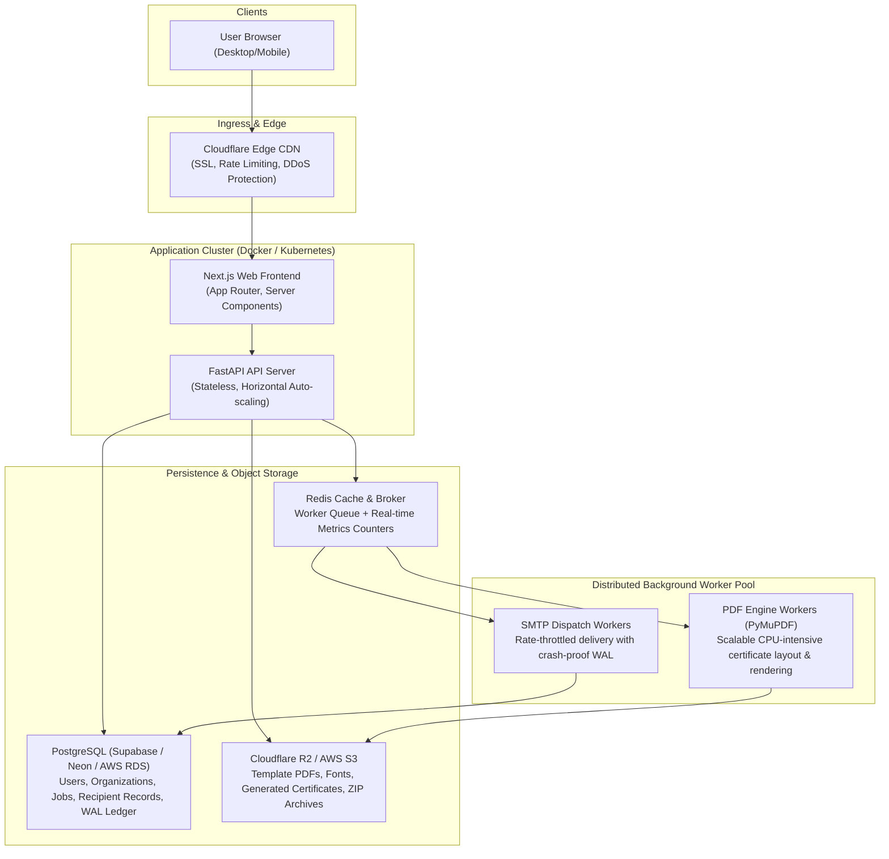

# galeus — Multi-User Production Deployment Guide

This guide describes how to take galeus from a single-instance organizer tool and scale it into a **multi-user SaaS platform** with distributed background workers, relational database persistence, S3 object storage, and real-time aggregate metrics.

---

## 1. High-Level Multi-Tenant Architecture



---

## 2. Multi-Tenant Database Schema (PostgreSQL)

In single-instance mode, galeus stores jobs as atomic JSON files in `data/jobs/{id}`. For multi-tenant production, migrate to PostgreSQL:

```sql
-- 1. Users and Organizations
CREATE TABLE organizations (
    id UUID PRIMARY KEY DEFAULT gen_random_uuid(),
    name TEXT NOT NULL,
    slug TEXT UNIQUE NOT NULL,
    created_at TIMESTAMPTZ DEFAULT NOW()
);

CREATE TABLE users (
    id UUID PRIMARY KEY DEFAULT gen_random_uuid(),
    org_id UUID REFERENCES organizations(id) ON DELETE CASCADE,
    email TEXT UNIQUE NOT NULL,
    full_name TEXT,
    role TEXT DEFAULT 'organizer', -- 'owner', 'admin', 'organizer'
    created_at TIMESTAMPTZ DEFAULT NOW()
);

-- 2. Certificate Jobs
CREATE TABLE jobs (
    id UUID PRIMARY KEY DEFAULT gen_random_uuid(),
    org_id UUID NOT NULL REFERENCES organizations(id) ON DELETE CASCADE,
    created_by UUID REFERENCES users(id),
    status TEXT NOT NULL DEFAULT 'created', -- 'created', 'analyzed', 'mapped', 'generating', 'generated', 'approved', 'sending', 'done', 'failed'
    placeholder TEXT NOT NULL DEFAULT 'AGENT',
    name_column TEXT,
    email_column TEXT,
    template_url TEXT NOT NULL,         -- S3 / R2 presigned key
    font_url TEXT,
    template_sha256 TEXT NOT NULL,
    approved_hash TEXT,                 -- Immutable SHA-256 seal
    approved_by UUID REFERENCES users(id),
    total_recipients INT DEFAULT 0,
    progress_count INT DEFAULT 0,
    created_at TIMESTAMPTZ DEFAULT NOW(),
    updated_at TIMESTAMPTZ DEFAULT NOW()
);

-- 3. Recipients (Partitioned / Indexed for fast pagination)
CREATE TABLE recipients (
    id BIGSERIAL PRIMARY KEY,
    job_id UUID NOT NULL REFERENCES jobs(id) ON DELETE CASCADE,
    row_id INT NOT NULL,
    raw_name TEXT NOT NULL,
    clean_name TEXT NOT NULL,
    email TEXT,
    email_status TEXT DEFAULT 'ok',
    flags TEXT[] DEFAULT '{}',
    status TEXT DEFAULT 'ready',        -- 'ready', 'generated', 'sent', 'failed', 'skipped'
    cert_s3_url TEXT,
    preview_s3_url TEXT,
    fit_report JSONB,
    created_at TIMESTAMPTZ DEFAULT NOW()
);
CREATE INDEX idx_recipients_job_id ON recipients(job_id);

-- 4. Global Aggregate Metrics
CREATE TABLE global_metrics (
    key TEXT PRIMARY KEY,
    counter BIGINT NOT NULL DEFAULT 0,
    last_updated TIMESTAMPTZ DEFAULT NOW()
);
-- Keys: 'total_certs_generated', 'total_emails_dispatched', 'total_batches_processed'
```

---

## 3. Cloud Object Storage (Cloudflare R2 / AWS S3)

Replace local filesystem storage (`data/jobs/{id}/certs`) with S3-compatible object storage:
* **Zero egress fees**: Cloudflare R2 is strongly recommended for serving large certificate PDFs and ZIP downloads because it charges \$0 for bandwidth/egress.
* **Direct Pre-signed Uploads**:
  1. Frontend requests upload ticket: `POST /api/jobs/upload-url` $\rightarrow$ returns pre-signed S3 PUT URL.
  2. Browser uploads template directly to S3 (bypassing backend server memory).
  3. Workers download the template, generate vector certificate PDFs, and upload results directly to S3.

---

## 4. Background Worker Queues (Celery / BullMQ + Redis)

For multiple concurrent users generating thousands of certificates simultaneously:
1. **Separation of Concerns**: The FastAPI web container only handles REST HTTP requests and responds in $< 50\text{ms}$.
2. **Worker Concurrency**:
   * **PDF Workers**: Celery workers run PyMuPDF across multiple CPU cores. A 1,000-attendee batch renders in under 8 seconds.
   * **SMTP Workers**: Dedicated workers pace outbound emails (e.g. 1.5s/email per user or integration with AWS SES API for 50 emails/sec).

---

## 5. Live Aggregate Metrics Engine

galeus includes a real-time aggregate metrics engine:
* **Endpoint**: `GET /api/metrics`
* **Response Payload**:
  ```json
  {
    "total_certs_generated": 1420,
    "total_emails_dispatched": 1180,
    "total_batches_processed": 18,
    "active_jobs": 0,
    "last_updated": 1793544520.12
  }
  ```
* In SaaS production, these counters are incremented atomically via Redis `INCRBY` and synced to PostgreSQL.

---

## 6. 1-Click Deployment (Railway / Render / Docker Compose)

A production `docker-compose.prod.yml` running the complete stack:

```yaml
version: '3.8'

services:
  web:
    build:
      context: ./web
      dockerfile: Dockerfile
    ports:
      - "3000:3000"
    environment:
      - NODE_ENV=production
      - BACKEND_URL=http://api:8000
    depends_on:
      - api

  api:
    build:
      context: .
      dockerfile: Dockerfile
    ports:
      - "8000:8000"
    environment:
      - DATA_DIR=/app/data
      - LLM_BASE_URL=${LLM_BASE_URL}
      - LLM_API_KEY=${LLM_API_KEY}
      - LLM_MODEL=${LLM_MODEL}
    volumes:
      - certclerk_data:/app/data

volumes:
  certclerk_data:
```

### Deploying to Railway / Render:
1. Connect your GitHub repository to **Railway** or **Render**.
2. Create two services:
   - **Backend**: Python environment, start command: `uvicorn api.main:app --host 0.0.0.0 --port 8000`.
   - **Frontend**: Node.js environment, start command: `npm run start` with `BACKEND_URL` pointing to the internal backend URL.
3. Add environment variables (`LLM_BASE_URL`, `LLM_API_KEY`, `LLM_MODEL`).
4. Done! galeus is live with SSL certificates and auto-scaling.


