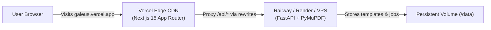

# Deploying galeus to Vercel (Step-by-Step Guide)

This guide walks you through deploying **galeus** to production so anyone can use it online.

---

## Architecture Overview



- **Frontend on Vercel**: Delivers the Next.js 15 UI, Geist typography, and the interactive motion graphic ad globally with ultra-low latency.
- **Backend on Railway or Render**: Runs FastAPI with PyMuPDF and the background email dispatch queue without serverless function timeout limits.
- **Zero CORS Bridge**: Next.js automatically rewrites `/api/*` requests to your backend URL. Your users only ever see and visit `https://your-app.vercel.app`.

---

## Step 1: Deploy the Backend (Railway — ~2 minutes)

1. Sign in to **[railway.app](https://railway.app/)** (free to start).
2. Click **New Project** ➔ **Deploy from GitHub repo**.
3. Select your repository: **`Ameya79/galeus`**.
4. Railway will automatically detect the root `Dockerfile` and start building.
5. In your Railway service dashboard, click the **Variables** tab and add:
   ```env
   DATA_DIR=/data
   FRONTEND_URL=https://your-project.vercel.app,http://localhost:3000
   GEMINI_API_KEY=your_optional_gemini_api_key
   ```
   *(Note: You can leave `GEMINI_API_KEY` blank to use the built-in rule-based invariant engine).*
6. In the **Settings** tab:
   - Under **Networking** ➔ Click **Generate Domain**.
   - Copy your public domain (e.g., `https://galeus-production.up.railway.app`).
7. *(Optional but recommended)*: Under **Volumes** ➔ Click **Add Volume** and mount it to `/data` so certificate jobs persist across container restarts.

---

## Step 2: Deploy the Frontend (Vercel — ~1 minute)

1. Sign in to **[vercel.com](https://vercel.com/)**.
2. Click **Add New...** ➔ **Project**.
3. Import your GitHub repository: **`Ameya79/galeus`**.
4. Configure the project settings:
   - **Framework Preset**: `Next.js` (detected automatically).
   - **Root Directory**: Click **Edit** and choose **`web`** (important! galeus frontend lives in `web/`).
5. Open the **Environment Variables** section and add:
   | Key | Value | Notes |
   | :--- | :--- | :--- |
   | `BACKEND_URL` | `https://galeus-production.up.railway.app` | *The domain generated in Step 1* |
6. Click **Deploy**.

---

## Step 3: Verify Your Live Deployment

1. Once Vercel finishes building, click on your live production URL (e.g. `https://galeus.vercel.app`).
2. **Landing Page**:
   - Verify the motion graphic ad plays cleanly.
   - Click **Open Studio Workstation**.
3. **Studio**:
   - Check the status pill at the top: it should show `LOCAL_DISPATCH_ENGINE: READY`.
   - Upload a test single-page Canva certificate PDF and attendee spreadsheet.
   - Click **Initialize Batch Pipeline** to verify the job creation and analysis run cleanly.

---

## Alternative: Free Backend on Render.com

If you prefer Render instead of Railway:
1. In **[render.com](https://render.com/)**, click **New +** ➔ **Web Service**.
2. Connect `https://github.com/Ameya79/galeus.git`.
3. Choose **Docker** as the runtime.
4. Set Instance Type: **Free** (or Starter).
5. Add environment variables:
   - `DATA_DIR`: `/tmp/data`
   - `FRONTEND_URL`: `https://your-project.vercel.app`
6. Copy the `.onrender.com` URL into Vercel's `BACKEND_URL`.
