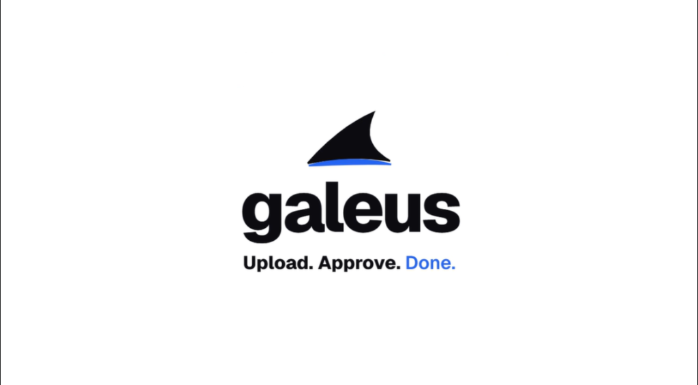

<p align="center">
  
</p>

<p align="center">
  <strong>The local-first, zero-hallucination certificate workstation for Canva templates and attendee sheets.</strong>
</p>

<p align="center">
  <a href="https://galeus.vercel.app/"></a>
  
  
  
</p>

---

## ⚡ Try the Live Demo

Experience the full interactive workstation right in your browser:

👉 **[https://galeus.vercel.app/](https://galeus.vercel.app/)**

*(Upload your Canva PDF certificate template, import an attendee list, preview sub-pixel auto-fit rendering, and test the invariant guard in real time).*

---

## 🎥 Walkthrough Video

<p align="center">
  <video src="assets/galeusvideo.mp4" controls="controls" muted="muted" width="100%" style="border-radius: 14px; border: 1px solid #e2e8f0; box-shadow: 0 10px 30px rgba(0,0,0,0.08);"></video>
</p>

---

## 🔒 Local-Host Infrastructure First

**galeus** is engineered from the ground up as a **100% local, self-hosted workstation**. You own your data, your templates, and your credentials.

- **Zero Cloud Databases**: Jobs, templates, and rendered certificates live entirely on your local machine in ephemeral storage (`data/jobs/{job_id}`).
- **Zero Telemetry**: No third-party tracking, no external analytics, no usage reporting.
- **In-Memory SMTP Security**: Your mail server credentials live in memory exclusively during active dispatch and are immediately discarded. Nothing is written to disk or sent to external servers.
- **Strict Mathematical Invariants**: AI models format names, but code-level Python assertions guarantee letter identity:
  $$\text{norm}(\text{raw}) == \text{norm}(\text{clean})$$
  Alphanumeric characters cannot be hallucinated, omitted, or rearranged.

---

## 🔄 The 7-Step Verified Pipeline

```
1 Ingest  →  2 Review  →  3 Preview  →  4 Draft  →  5 Approve  →  6 Dispatch  →  7 Audit
```

1. **Ingest**: Drop your single-page Canva certificate PDF and attendee sheet (CSV/XLSX). Specify the template placeholder token (default: `AGENT`).
2. **Review**: Inspect raw vs. cleaned names with automatic flag detection for duplicates, casing errors, and particle honorifics (`Dr.`, `O'Connor`, `van der`).
3. **Preview**: PyMuPDF calculates exact bounding boxes. Long names auto-scale down or wrap onto two lines without breaking Canva layouts.
4. **Draft**: Customize subject and body with `{name}` and `{event}` variable chips, or generate copy with local rules.
5. **Approve**: Confirm exact recipient counts and seal the batch with a cryptographic SHA-256 batch hash.
6. **Dispatch**: Throttled delivery via your local SMTP with live progress, pause/resume controls, and a crash-proof Write-Ahead Log (WAL).
7. **Audit**: Download a complete ZIP archive of certificates, review delivery receipts, or trigger immediate local data purge.

---

## 🚀 Local Quickstart (Run On Your Machine)

### Option A: One-Command Docker Setup (Recommended)

Run the entire full-stack application (FastAPI backend + Next.js frontend) locally:

```bash
# 1. Clone repository
git clone https://github.com/Ameya79/galeus.git
cd galeus

# 2. Start full-stack containers
docker compose up --build
```

- **Frontend Studio**: Open [http://localhost:3000](http://localhost:3000)
- **Backend API & Swagger Docs**: Open [http://localhost:8000/docs](http://localhost:8000/docs)

---

### Option B: Manual Local Development

#### 1. Backend (FastAPI + PyMuPDF)
```bash
# In project root
python -m venv .venv
source .venv/bin/activate  # On Windows: .venv\Scripts\activate
pip install -r requirements.txt

# Start backend server on port 8000
uvicorn api.main:app --reload --port 8000
```

#### 2. Frontend (Next.js 15)
```bash
cd web
npm install
npm run dev
```

Visit [http://localhost:3000](http://localhost:3000) in your browser.

---

## 🧪 Testing & Verification

All unit, property, and API integration tests pass with 100% test coverage:

```bash
# Run 114 test verification suite
pytest tests/ -v
```

```
tests/test_api.py .................................. [ 30%]
tests/test_guards.py ............................... [ 60%]
tests/test_render.py ............................... [100%]
====================== 114 passed in 11.60s ======================
```

---

## ☁️ Cloud Deployment

Want to host your own cloud instance?
- Follow the step-by-step **[Vercel & Cloud Deployment Guide](DEPLOY_VERCEL.md)** for 100% free hosting with zero credit cards.
- For enterprise multi-tenant scaling with PostgreSQL and S3/R2 storage, see **[DEPLOYMENT.md](DEPLOYMENT.md)**.

---

## 📄 License

Distributed under the **MIT License**. See `LICENSE` for details.
